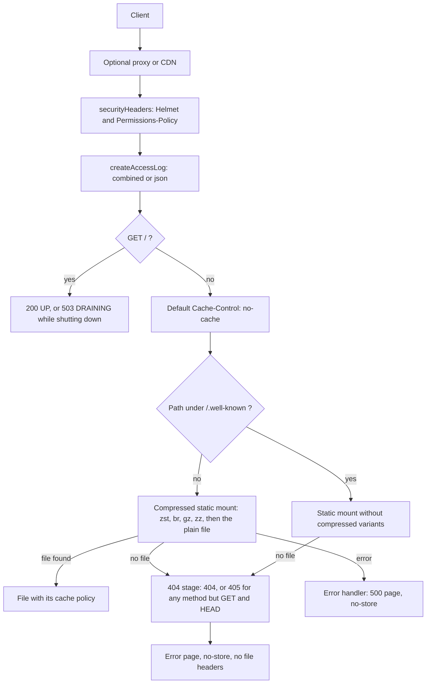
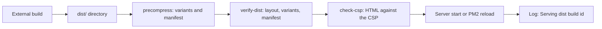

# Architecture

How a request moves through `express-static-serve`, how a `dist/` build reaches it, and which
module owns what. The invariants themselves live in [AGENTS.md](../AGENTS.md).

## Request flow

The middleware order is an invariant: Helmet, Morgan, routes, static files, the 404 stage, then the
error handler. Every stage has one owner in `server.js`.

Notes on the stages:

- **Access log:** `TRUST_PROXY` decides which address is logged, and only the log reads it.
- **Health route:** it is registered before the static stage, so `GET /` is never a file. The
  server answers it even when `dist/` is missing.
- **Static mount:** `express-static-gzip` lists the compressed variants once at startup. The
  cache policy is set per file by `lib/cache-policy.js`.
- **Error pages:** the 404 stage and the error handler share `resetFileHeaders`, because the static
  layer sets `Content-Encoding` and other file headers before it knows it will send the file.

## The dist pipeline

`dist/` is built outside this repository by design. `prepare-dist` is the single post-build step.

`prepare-dist` runs the three middle steps and runs the checks even if `precompress` fails. Any
finding fails the command. The server never runs the build.

## Modules

| Module                         | Role                                                            |
| ------------------------------ | --------------------------------------------------------------- |
| `server.js`                    | `createApp()` builds the app, `start()` parses and listens       |
| `lib/config.js`                | Strict parsing of every environment variable                    |
| `lib/security-headers.js`      | Helmet, the single `CSP_DIRECTIVES`, `Permissions-Policy`       |
| `lib/cache-policy.js`          | `Cache-Control` per file name                                   |
| `lib/access-log.js`            | Morgan setup, the JSON format, escaping of log values           |
| `trust-proxy.js`               | The `TRUST_PROXY` parser                                        |
| `ecosystem.config.js`          | PM2 cluster mode and the forwarded environment                  |
| `scripts/precompress.js`       | Writes the variants and the manifest                            |
| `scripts/verify-dist.js`       | Checks layout, variants, symlinks, dot entries, manifest        |
| `scripts/check-csp.js`         | Regex lint of the HTML against `CSP_DIRECTIVES`                 |
| `scripts/prepare-dist.js`      | Runs the three scripts above in order                           |
| `views/`                       | The 404, 405, and 500 pages                                     |

## See also

- [Threat model](threat-model.md) for what each stage defends against.
- [Runbook](runbook.md) for deploying and operating the server.
- [Decision records](adr/README.md) for why the structure is this way.
